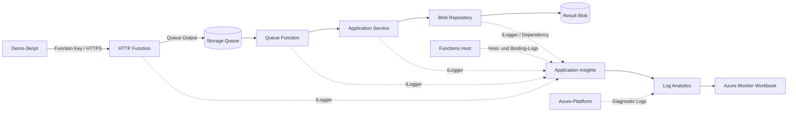

# Azure Functions Logging Demo

Dieses Beispiel zeigt nachvollziehbar, welche Logs und Telemetriedaten in den verschiedenen Schichten einer C# Azure Function entstehen. Ein HTTP-Trigger nimmt einen Demoauftrag an, Azure Queue Storage entkoppelt die Verarbeitung und ein Queue-Trigger durchlaeuft eine Application- und eine Infrastructure-Schicht.

Die Loesung verwendet:

- .NET 10 und Azure Functions v4 im Isolated-Worker-Modell
- Azure Functions Flex Consumption (FC1)
- Azure Queue und Blob Storage
- Managed Identity und rollenbasierte Zugriffe
- Workspace-basiertes Application Insights und Log Analytics
- Terraform fuer Infrastruktur und den gekapselten One-Deploy-Schritt

## Architektur



## Welche Schicht erzeugt welche Telemetrie?

| Quelle | Beispielkategorie | Typische Information | Ziel |
|---|---|---|---|
| HTTP Function | `LoggingDemo.Functions.SubmitDemoFunction` | Request, Validierung, HTTP-Status | `AppRequests`, `AppTraces` |
| Queue Function | `LoggingDemo.Functions.ProcessDemoFunction` | Invocation, Message ID, Dequeue Count, Retry | `AppTraces`, `AppExceptions` |
| Application Service | `LoggingDemo.Application.DemoProcessor` | fachliche Schritte und Entscheidungen | `AppTraces` |
| Blob Repository | `LoggingDemo.Infrastructure.BlobResultRepository` | Beginn/Ende einer Speicheroperation | `AppTraces` |
| Azure Storage SDK | Azure SDK / Dependency Tracking | Queue- und Blob-Aufrufe, Dauer, Erfolg | `AppDependencies` |
| Isolated Worker | Worker- und Function-Kategorien | Ausfuehrung im separaten .NET-Worker | `AppTraces` |
| Functions Host | `Host.*`, `Function.*` | Trigger, Binding, Invocation und Retry | `AppTraces`, `AppRequests` |
| Azure-Plattform | Function-App-Diagnosekategorien | Plattform- und Konsolenereignisse | Workspace-spezifische Azure-Diagnostics-Tabellen |
| Azure Resource Manager | Activity Log | Deployment- und Konfigurationsaenderungen | Azure Activity Log |

Eigene Logs tragen strukturierte Dimensionen wie `DemoLayer`, `Scenario`, `CorrelationId`, `MessageId` und `DequeueCount`. Dadurch koennen sie ohne Textsuche gefiltert und gruppiert werden.

> `host.json` steuert die Log-Level und das Retry-Verhalten des Functions Hosts. Die Filter fuer die Anwendung im Isolated Worker werden dagegen in `Program.cs` konfiguriert. Genau diese Trennung ist ein zentraler Bestandteil der Demo.

## Demo-Szenarien

| Szenario | Erwartetes Verhalten |
|---|---|
| `success` | HTTP-Annahme, Queue-Verarbeitung und Blob-Schreibvorgang sind erfolgreich. |
| `validation` | Die HTTP Function protokolliert eine Warning und antwortet mit HTTP 400; es entsteht keine Queue-Nachricht. |
| `transient` | Die Queue Function scheitert kontrolliert bei fruehen Zustellversuchen und ist danach erfolgreich. |
| `poison` | Jeder Zustellversuch scheitert; nach der konfigurierten Grenze verschiebt der Host die Nachricht nach `work-items-poison`. |
| `dependencyFailure` | Die Infrastructure-Schicht erzeugt kontrolliert einen Fehler, der als strukturierter Trace und Exception sichtbar wird. |

Die kurzen Retry-Grenzen und die vollstaendige Telemetrie sind Demo-Einstellungen und keine pauschalen Produktionsempfehlungen.

## Voraussetzungen

- PowerShell 7
- [.NET SDK 10](https://dotnet.microsoft.com/download/dotnet/10.0)
- [Terraform](https://developer.hashicorp.com/terraform/install) 1.6 oder neuer
- [Azure CLI](https://learn.microsoft.com/cli/azure/install-azure-cli)
- Eine Azure Subscription und Berechtigungen zum Erstellen der geplanten Ressourcen und Rollenzuweisungen

Anmeldung und Subscription-Auswahl:

```powershell
az login
az account set --subscription "<subscription-id>"
az account show --output table
```

## Lokal bauen und testen

Das Build-Skript stellt Abhaengigkeiten wieder her, fuehrt die Tests aus, publiziert die Function und erzeugt das ZIP-Paket:

```powershell
.\scripts\Build-FunctionPackage.ps1
```

Direkte Befehle:

```powershell
dotnet test .\tests\LoggingDemo.Tests\LoggingDemo.Tests.csproj
dotnet publish .\src\LoggingDemo.Functions\LoggingDemo.Functions.csproj -c Release
```

Fuer den vollstaendigen lokalen Function-Ablauf wird Azurite benoetigt. Die lokale Einstellungsdatei darf Connection Strings enthalten und wird deshalb nicht eingecheckt:

```powershell
Copy-Item `
    .\src\LoggingDemo.Functions\local.settings.example.json `
    .\src\LoggingDemo.Functions\local.settings.json
```

## Azure-Infrastruktur ausrollen

Beispielvariablen kopieren und anpassen:

```powershell
Copy-Item .\infra\terraform.tfvars.example .\infra\terraform.tfvars
```

Initialisieren und pruefen:

```powershell
terraform -chdir=infra init
terraform -chdir=infra fmt -check
terraform -chdir=infra validate
terraform -chdir=infra plan -out main.tfplan
```

Ausrollen:

```powershell
terraform -chdir=infra apply main.tfplan
```

Der Apply-Lauf erstellt zuerst Infrastruktur und RBAC. Anschliessend baut ein hash-gesteuerter `terraform_data`-Schritt das ZIP und veroeffentlicht es ueber Azure CLI One Deploy. Dieser imperative Schritt ist bewusst isoliert: Flex Consumption besitzt im AzureRM-Provider keinen verlaesslichen deklarativen `zip_deploy_file`-Pfad.

Nach erfolgreichem Apply:

```powershell
$resourceGroup = terraform -chdir=infra output -raw resource_group_name
$functionApp = terraform -chdir=infra output -raw function_app_name
$workspace = terraform -chdir=infra output -raw log_analytics_workspace_name
```

## Szenarien ausfuehren

Alle Szenarien:

```powershell
.\scripts\Invoke-LoggingDemo.ps1 `
    -ResourceGroupName $resourceGroup `
    -FunctionAppName $functionApp
```

Nur ein Szenario:

```powershell
.\scripts\Invoke-LoggingDemo.ps1 `
    -ResourceGroupName $resourceGroup `
    -FunctionAppName $functionApp `
    -Scenario transient
```

Das Skript fragt den Function Key zur Laufzeit ueber Azure CLI ab. Der Key wird weder gespeichert noch als Terraform-Output ausgegeben. Application-Insights-Telemetrie kann mit einigen Minuten Verzoegerung eintreffen.

## Logs abfragen

Eine ausgegebene Correlation ID kann direkt verwendet werden:

```powershell
.\scripts\Query-LoggingDemo.ps1 `
    -ResourceGroupName $resourceGroup `
    -WorkspaceName $workspace `
    -CorrelationId "<correlation-id>" `
    -Query timeline
```

Verfuegbare Abfragen:

- `timeline`: gemeinsame Timeline aus Requests, Traces, Dependencies und Exceptions
- `retries`: Dequeue Count, Retry und Poison-Szenario
- `categories`: Gruppierung nach Function-, Application-, Infrastructure-, Worker- und Host-Quelle
- `failures`: fehlgeschlagene Dependencies und Exceptions

Die zugrunde liegenden KQL-Dateien liegen unter `queries`.

Das Azure Workbook ist an die Application-Insights-Komponente gebunden und
verwendet deshalb das Komponentenschema mit `traces`, `exceptions`,
`dependencies` und `customDimensions`. Direkte Abfragen des zugeordneten
Log-Analytics-Workspace verwenden dagegen die Workspace-Tabellen
`AppTraces`, `AppExceptions`, `AppDependencies` und `Properties`.

## Empfohlener Kundenablauf

1. Das Workbook ohne Filter oeffnen und die unterschiedlichen Telemetrietypen erklaeren.
2. `success` ausfuehren und anhand der Correlation ID durch Function-, Application- und Infrastructure-Schicht navigieren.
3. In `Program.cs` die Worker-Filter und in `host.json` die Host-Filter gegenueberstellen.
4. `validation` ausfuehren und zeigen, dass kein Queue- oder Dependency-Ereignis folgt.
5. `transient` ausfuehren und die Dequeue Counts sowie Exceptions bis zum erfolgreichen Versuch verfolgen.
6. `poison` ausfuehren und die Host-Retries sowie die Poison Queue zeigen.
7. `dependencyFailure` ausfuehren und Trace, Exception und fehlgeschlagene Dependency vergleichen.
8. Sampling, Telemetriekosten, Datenschutz und produktive Log-Level diskutieren.

## Produktionshinweise

- Sampling fuer volumenstarke Systeme aktivieren und Ausnahmen fuer wichtige Telemetrietypen bewusst festlegen.
- Log-Level pro Kategorie statt globalem `Debug` oder `Trace` konfigurieren.
- Keine Payloads, Tokens, Connection Strings, Function Keys oder personenbezogenen Daten protokollieren.
- Private Endpoints, VNet-Integration und restriktive Netzwerkregeln entsprechend dem Zielsystem ergaenzen.
- Retry-Grenzen und Visibility Timeout an Verarbeitung und Nebenwirkungen anpassen.
- Queue-Verarbeitung idempotent gestalten.
- Alerts fuer Fehlerrate, Poison Messages und Dependency-Fehler ergaenzen.

## Fehlerbehebung bei Flex Consumption

### `Failed to fetch host key to check for function app status`

Bei keyless Storage kann AzureRM zusaetzlich zu den
`AzureWebJobsStorage__*`-Einstellungen einen ungueltigen exakten
`AzureWebJobsStorage`-Connection-String mit leerem `AccountKey` erzeugen.
Der exakte Wert hat Vorrang und verhindert den Host-Start. Die
Terraform-Konfiguration neutralisiert diesen Provider-Wert deshalb explizit
und verwendet Managed Identity sowie Blob-, Queue- und Table-Endpunkte.

Der Fehler ist behoben, wenn ein erneutes `terraform apply` mit
`Deployment was successful` endet und die Functions ueber ARM sichtbar sind.

### Worker startet wiederholt neu

Die Functions-Application-Insights-Integration verwendet die kompatible
2.x-Version von `Microsoft.ApplicationInsights.WorkerService`. Version 3.x
entfernt Typen, die von der aktuellen Functions-Integration benoetigt werden,
und fuehrt beim Worker-Start zu einer `TypeLoadException`.

Nach Paket- oder Konfigurationsaenderungen:

```powershell
terraform -chdir=infra apply
.\scripts\Invoke-LoggingDemo.ps1 `
    -ResourceGroupName (terraform -chdir=infra output -raw resource_group_name) `
    -FunctionAppName (terraform -chdir=infra output -raw function_app_name) `
    -Scenario success
```

## Aufraeumen

```powershell
terraform -chdir=infra destroy
```

Vor dem Destroy sicherstellen, dass die Resource Group keine fremden Ressourcen enthaelt.
